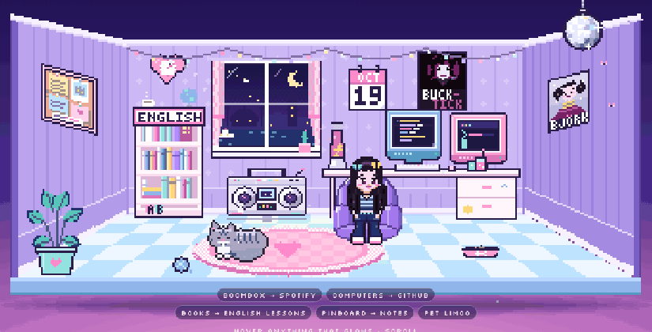
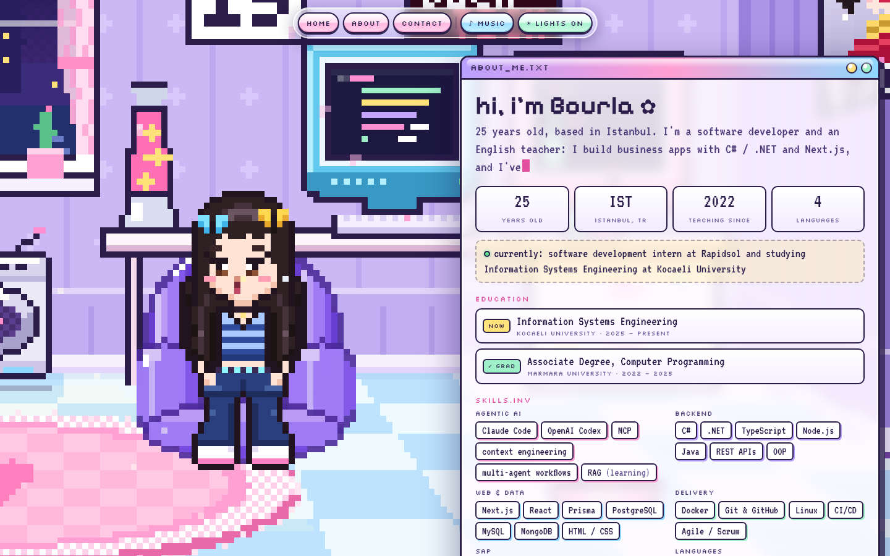
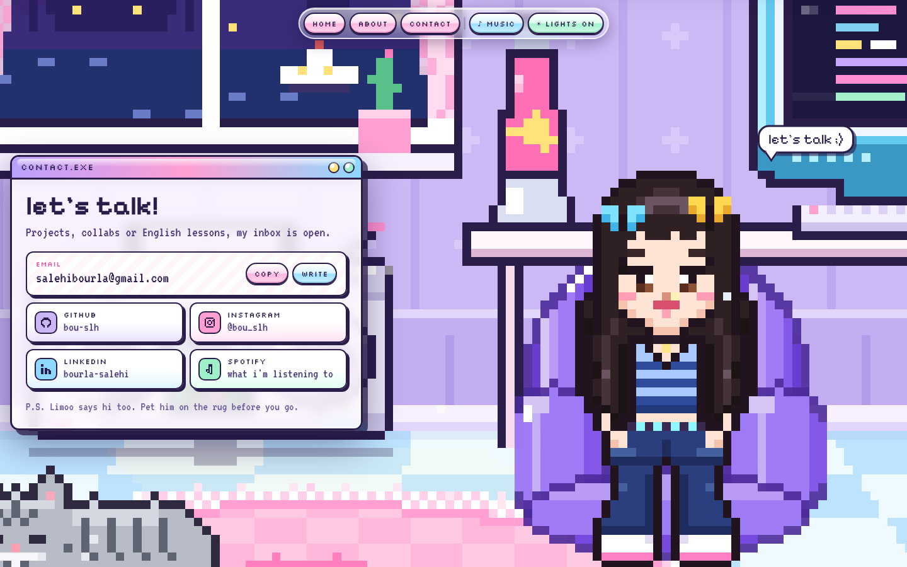
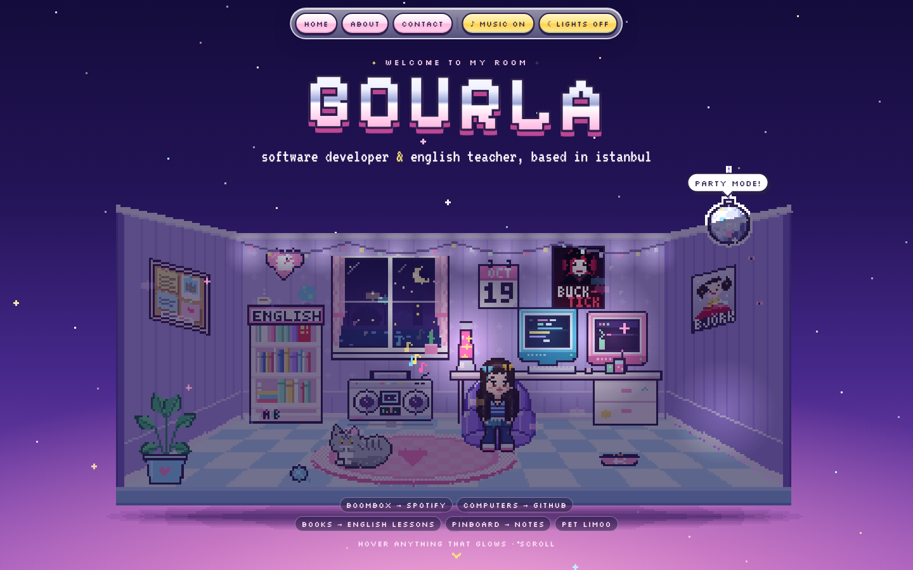
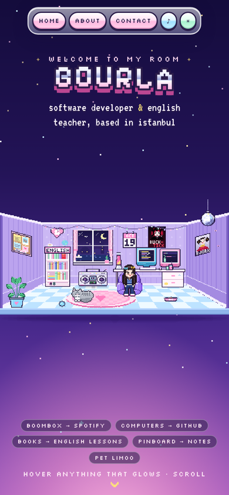

<div align="center">

# ✦ Bourla's Room ✦

**An interactive pixel-art portfolio, hand-drawn in code. Zero frameworks, zero image files.**

[**▶ Live demo**](https://bou-slh.github.io/myportfolio/) · [LinkedIn](https://www.linkedin.com/in/bourla-salehi) · [Email](mailto:salehibourla@gmail.com)



</div>

## Hi, I'm Bourla 👋

I'm a 25-year-old **software developer and English teacher based in Istanbul**. I build business apps with C# / .NET and Next.js, work with AI agent tooling (MCP, multi-agent workflows, RAG), and currently intern in software development while studying Information Systems Engineering at Kocaeli University. I hold an associate degree in Computer Programming from Marmara University.

This repo is my portfolio: a cozy Y2K bedroom you can explore. Every object is a door to something about me.

## What you can do in the room

| Click / hover | What happens |
| --- | --- |
| 🖥️ The two CRT monitors | Opens my GitHub profile |
| 📻 The boombox | Opens my Spotify |
| 📚 The **ENGLISH** bookshelf | English tutoring info and a mini quiz |
| 📌 The pinboard | Sticky notes about what I'm working on |
| 🐱 Limoo on the rug | Pet my British Shorthair (he keeps count) |
| 🪩 The disco ball | Party mode: lights, faster beat, dance track |
| 🌋 The lava lamp | Lights on / off |
| 🪟 The window | Live Istanbul sky that follows real local time |
| 👩 Me | Say hi. I also wink at you in the contact section |

Scrolling moves a camera through the room: the hero view, then an About window, then Contact, while the avatar keeps tracking your cursor.

## Screenshots

<p align="center">
  
  
</p>
<p align="center">
  
  
</p>

## How it's built

No React, no game engine, no sprite sheets. Everything you see is drawn pixel by pixel with the Canvas 2D API.

- **Custom pixel renderer.** The room is a 384×216 logical canvas scaled up with nearest-neighbour sampling. A small toolkit (`src/js/gfx.js`) provides scanline polygon and ellipse fills without anti-aliasing, sprites built from character maps, auto-outlines and per-column shearing for the perspective side walls.
- **One-point perspective scene.** Objects are depth-sorted and redrawn every frame; hover glows are generated from each sprite's own silhouette.
- **Procedural characters.** The avatar's face (blinks, winks, mouth shapes, eye tracking) and Limoo's breathing, tail and ears are composed in code, so animations stay crisp at any scale.
- **Scroll-driven camera.** Eased, damped keyframes with separate portrait and landscape framings, so it works on phones too.
- **Generative music with Web Audio.** Both tracks are synthesized live: a chill 66 BPM dream-pop loop (FM bells, pads, convolution reverb from a generated impulse) and a 124 BPM house track for party mode. Plus soft UI click and meow sounds.
- **Accessible by default.** Every interactive object is a real `<a>` or `<button>` positioned over the canvas, so it works with keyboard and screen readers. `prefers-reduced-motion` is respected.
- **Ships as one file.** `build.js` inlines the CSS and JS into a single ~130 KB `index.html`.

```
src/
  page.html      markup for the sections and modals
  style.css      Y2K UI theme
  js/gfx.js      pixel-art drawing toolkit
  js/font.js     3×5 pixel font for in-world labels
  js/avatar.js   the avatar sprite and facial animation
  js/cat.js      Limoo
  js/scene.js    the room, props, lighting and particles
  js/main.js     camera, hotspots, interactions, audio engine
build.js         bundles everything into index.html
```

## Run it locally

```bash
git clone https://github.com/bou-slh/myportfolio.git
cd myportfolio
open index.html          # or just double-click it
```

After editing anything in `src/`, rebuild with `node build.js` (Node 18+, no dependencies).

## Skills on display

`JavaScript` `Canvas 2D` `Web Audio API` `HTML / CSS` `Responsive design` `Accessibility` `Animation` `Pixel art`

My wider stack: C#, .NET, TypeScript, Node.js, Java, Next.js, React, Prisma, PostgreSQL, MySQL, MongoDB, Docker, Linux, CI/CD, SAP (Fiori / UI5, ABAP basics, HCM) and AI tooling (Claude Code, MCP, multi-agent workflows, RAG). I speak English, Turkish, Persian and Arabic.

## Let's talk

Open to software roles, collaborations and English students.
📧 salehibourla@gmail.com · [LinkedIn](https://www.linkedin.com/in/bourla-salehi) · [Instagram](https://www.instagram.com/bou_slh/)

<sub>Inspired by the cozy-room portfolio genre. Built with the help of Claude.</sub>
